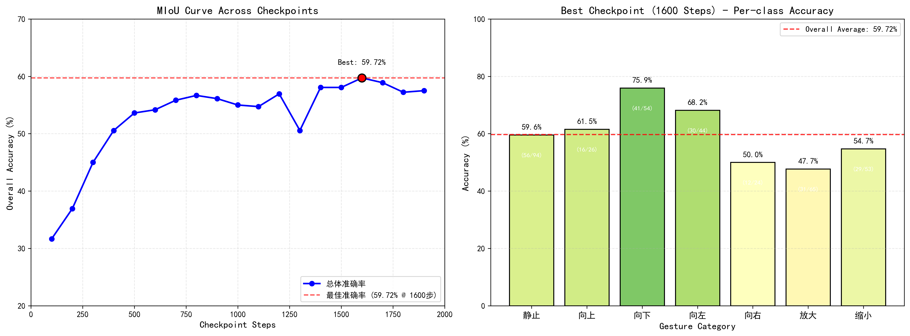

# VLA_Baseon_Qwen3
# 基于QWenVLA模型的腹腔镜预测

基于 QwenVL 的手术视频理解模型训练与评估项目，支持多帧采样、数据集预处理、逐轮 checkpoint 评估与可视化。

## 📁 项目结构

```
.
├── checkpoint-1600/                          # 最佳模型权重（对应第 1600 轮训练步）
├── qwenvl/                                   # 训练运行核心代码与数据集分割逻辑
├── 12frames_6sample_pre.py                   # 数据集预处理分割（12 张图片 / 6 样本格式）
├── evaluate_checkpoints.py                   # 逐轮校验各 checkpoint 的模型准确率
├── model_performance_summary.png             # 模型性能汇总图（预留位置）
├── surgery_train_12frames_6sample...         # 训练集数据分割与展示文件
├── surgery_val_12frames_6samples.j...        # 验证集数据分割与展示文件
└── vis.py                                    # 生成可视化结果列表的脚本
```

## 🔍 模块说明

| 文件 / 目录 | 说明 |
| --- | --- |
| `checkpoint-1600/` | 本次训练筛选出的最佳模型权重，对应 1600 轮训练步 |
| `qwenvl/` | 存放训练运行核心代码与数据集分割逻辑 |
| `12frames_6sample_pre.py` | 按 12 张图片、6 样本格式完成数据集预处理分割 |
| `evaluate_checkpoints.py` | 逐轮校验各 checkpoint 的模型准确率 |
| `model_performance_summary.png` | 预留模型性能汇总图位置 |
| `surgery_train_12frames_6sample...` | 训练集数据分割与展示文件 |
| `surgery_val_12frames_6samples.j...` | 验证集数据分割与展示文件 |
| `vis.py` | 生成可视化结果列表的脚本 |

## 🚀 快速开始

### 环境依赖

> TODO：补充 Python 版本、CUDA 版本及依赖安装命令

```bash
# 示例
pip install -r requirements.txt
```

### 数据集预处理

按 12 张图片、6 样本格式对数据集进行分割：

```bash
python 12frames_6sample_pre.py
```

### 模型训练

> TODO：补充训练启动命令与相关参数说明

```bash
# 示例
bash qwenvl/train.sh
```

### 模型评估

逐轮校验各 checkpoint 的准确率：

```bash
python evaluate_checkpoints.py
```

### 结果可视化

生成可视化结果列表：

```bash
python vis.py
```

## 📊 模型性能

> TODO：训练完成后，将性能汇总图放置于 `model_performance_summary.png`



## 🏆 最佳权重

本次训练筛选出的最佳模型权重为 **`checkpoint-1600`**，对应第 **1600** 轮训练步。


## 🙏 致谢

Qwen3开源项目
